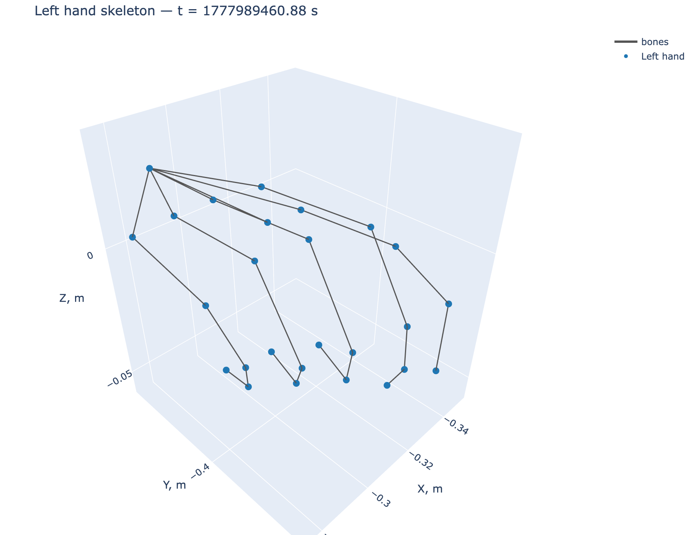
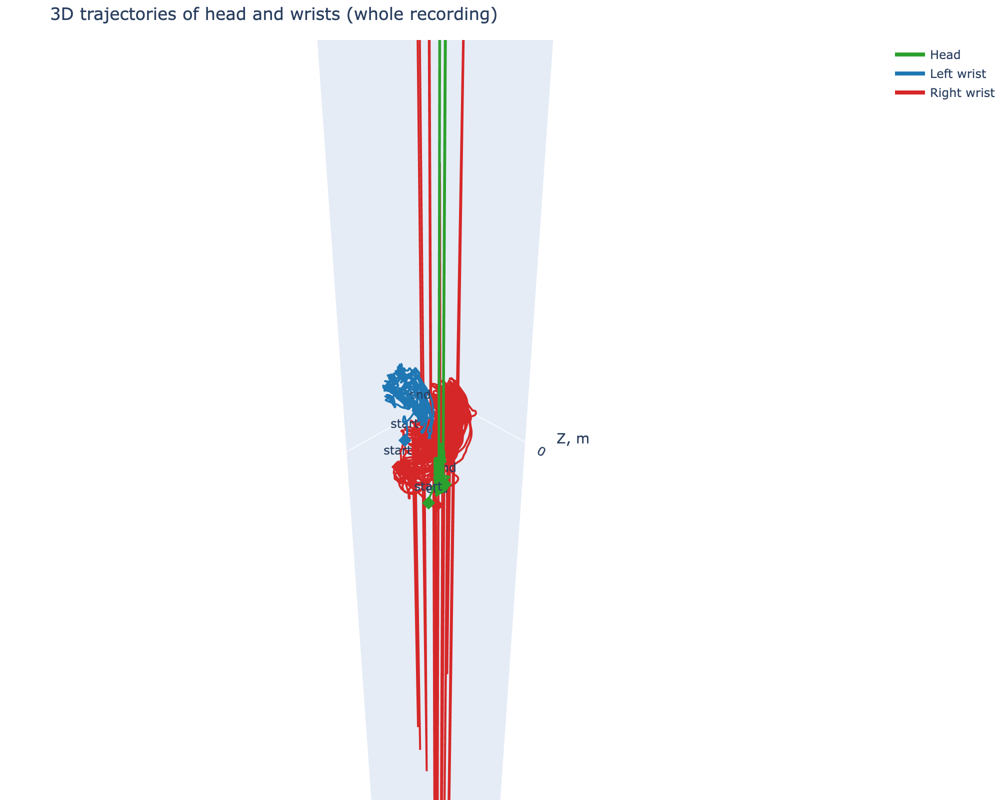

# XR Tracking Visualization

Интерактивная 3D-визуализация данных трекинга VR-устройства
(формат XRoboToolkit) на основе `trackingData_20260505_165740.txt`.


---

## Метод

Выбран вариант **«отображение положения рук и головы в 3D»**:
визуализируются непосредственно данные трекера, без наложения на видео.
Скрипт строит три представления:

1. **3D-скелет кисти** в первом кадре с активной рукой - все 26 суставов
   OpenXR Hand и связи между ними. Показывает качество трекинга мелкой
   моторики.
2. **3D-траектории головы и запястий** по всей записи - пространственная
   картина движения: амплитуда, зоны активности, асимметрия рук.
3. **Описательная статистика** (`output/stats.json`): длительность,
   пройденный путь, число кадров с активной рукой, максимальный шаг
   между кадрами (детектор выбросов).


HTML-файлы интерактивные


---

## Пример результата

### Скелет кисти (первый кадр с активной рукой)



Все 26 суставов отслеживаются, связи между ними корректны, форма
облака соответствует полураскрытой ладони.

### Траектории головы и запястий (вся запись, ~4 минуты)



Зелёная линия - голова, синяя - левое запястье, красная - правое.
Ромбы `start` / `end` отмечают начало и конец каждой траектории.
Интерактивная версия: [`output/trajectories.html`](output/trajectories.html)
(открывается в браузере)

Статистика: [`output/stats.json`](output/stats.json).

---

## Запуск

При запуске кода файл trackingData_20260505_165740.txt должен быть в директории /data
Для просмотра HTML требуется использовать open

```bash
python -m venv .venv && source .venv/bin/activate   
pip install -r requirements.txt
python app.py --input data/trackingData_20260505_165740.txt
open open output/trajectories.html
open output/hand_skeleton_left.html

```

Результаты появятся в `output/`:

| Файл | Что это |
|---|---|
| `hand_skeleton_left.html` / `.png` | 3D-скелет кисти |
| `trajectories.html` / `.png` | 3D-траектории головы и запястий |
| `stats.json` | Числовая статистика |


---

## Наблюдения по данным

Запись ~4 минуты (`duration_s = 242.542`), **21787 кадров** трекинга,
обе руки активны почти на всём протяжении
(`left_active_frames = 21787`, `right_active_frames = 21652`).

- **Правая рука двигалась значительно интенсивнее левой:**
  `right_wrist_path_m = 237.94` против `left_wrist_path_m = 17.37`. На графике правая траектория образует плотный
  клубок - характерно для активной подвижности. Левая рука почти неподвижна.
- **`head_path_m = 60.29` при компактном облаке головы указывает на
  выбросы трекинга** - кратковременные скачки позиции. Суммарная
  длина пути поэтому завышена; для оценки реальной амплитуды
  корректнее смотреть на сам 3D-график.
- **Скелет кисти** показывает полураскрытую ладонь, все 26 суставов
  отслеживаются корректно.
- Оси в сцене: X - вправо, Y - вверх, Z - вперёд/назад
  (система координат трекера).

---

## Возникшие сложности

1. **Десятичная запятая.** В полях `pose` и `p` десятичный разделитель —
   запятая, и поля тоже разделены запятой.
   Решение: матчить **число целиком** регуляркой `-?\d+(?:,\d+)?`
   через `findall` - это единственный корректный способ разобрать
   формат с совпадающими разделителями.
2. **Первая строка файла - метаданные камеры**, а не кадр трекинга
   (`cameraExtrinsics`, `cameraIntrinsics`, `timeStampNs`). Скрипт
   отличает их по наличию ключей `Head` / `Hand`.
3. **Разные единицы времени:** `timeStampNs` в наносекундах,
   `predictTime` - в секундах. В статистике используется первое,
   с фолбэком на второе.
4. **Неактивные руки.** При `isActive == 0` массив
   `HandJointLocations` всё равно присутствует, но с нулевой
   валидностью (`s: 0.0`). Данные фильтруются по `isActive`.
5. **Выбросы трекинга.** Одиночные скачки позиции раздувают суммарный
   путь в разы. Метрика `path_length` этого не различает; поэтому в
   `stats.json` добавлен `max_*_step_m` - максимальный шаг между
   соседними кадрами, прямой индикатор выбросов.

---

## Про видео

MP4 (`CameraRecord_20260505_165740.mp4`) не используется:
выбранный метод визуализирует сами данные трекера. По заданию достаточно одного подхода, и он выбран.

---

## Итог:

Выбранный метод - интерактивная 3D-визуализация данных
трекинга (скелет кисти + траектории головы и запястий + статистика) -
позволяет без синхронизации с видео оценить и качество трекинга, и
характер движения; основные сложности были связаны с нестандартным
форматом чисел (десятичная запятая) и выбросами трекера, которые
видны на графике головы.